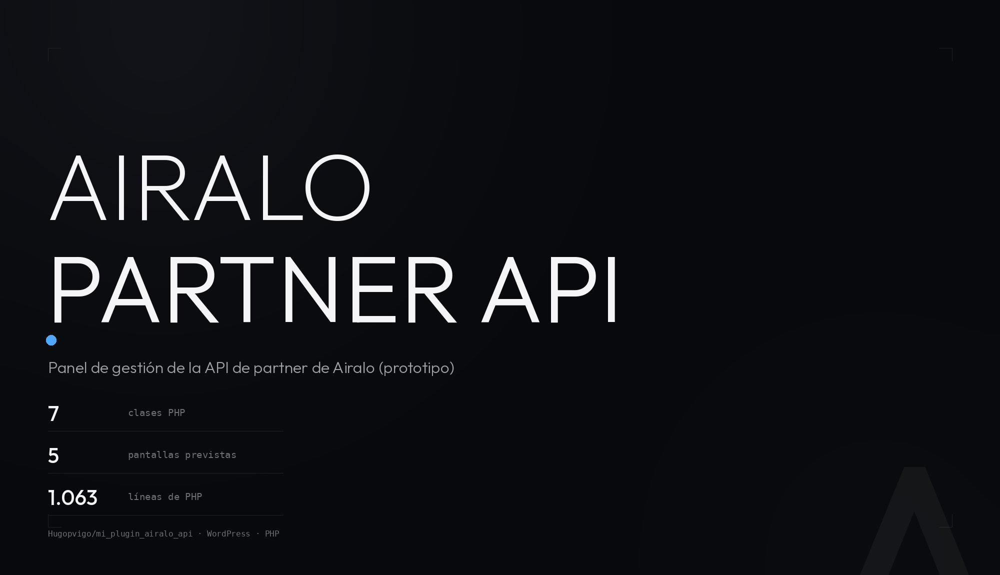

<p align="center">
  
</p>

<p align="center">
  <b>Panel de gestión de la API de Airalo para WordPress.</b><br>
  Borrador en construcción: dashboard, consulta de eSIMs por ICCID, estados de orden,
  visor de logs y configuración del modo sandbox/producción.
</p>

<p align="center">
  
  
  
  
  
</p>

---

## Qué es esto

Un plugin de WordPress para manejar la **Airalo Partner API** desde el panel de administración,
en lugar de llamar a la API a mano:

- **Dashboard** con el estado de la conexión, el modo activo y accesos rápidos.
- **Consulta de eSIM** por ICCID: estado, país, fechas, datos restantes y paquete contratado.
- **Estados de orden** de Airalo, con buscador por nombre y paginación.
- **Visor de logs** en el admin, con rotación y purga de ficheros antiguos.
- **Página de ajustes** para elegir entre el entorno `sandbox` y `production`.

## Estado del proyecto

**Es un prototipo: todavía no arranca.** Conviene saberlo antes de instalarlo. Lo que falta:

- `api-airalo.php` carga `includes/security-checks.php`, **que no está en el repositorio**. El
  `require_once` de un fichero inexistente es un error fatal, así que el plugin no llega a
  registrar ni el menú.
- `templates/admin/logs.php` tiene un **error de sintaxis** en la línea 9 (`isset(…)` sin cerrar),
  así que la vista de logs no se puede cargar.
- Las clases de `includes/` **nunca se cargan**: `api-airalo.php` no las incluye, así que el
  dashboard y el cliente REST que hay en `includes/` no llegan a usarse. El menú que registra el
  fichero principal es otro, con subpáginas de ejemplo (`Submit Order`, `Get Order`,
  `Update eSIM`) que además apuntan a funciones comentadas en el propio fichero.
- `Airalo_API_Handler::request_new_token()` **devuelve un token simulado**: nunca llama al
  endpoint de autenticación de Airalo, así que las peticiones reales a la API fallarían.
- Faltan las constantes `AIRALO_API_PLUGIN_DIR`, `AIRALO_API_PLUGIN_URL`, `AIRALO_API_VERSION` y
  `AIRALO_API_LOG_DIR`, que usan las clases y las plantillas, y los ficheros
  `templates/admin/log-viewer.php` y `assets/js/admin.js`.

El repositorio está aquí para dejar el diseño a la vista y seguir con él; no es una release.

## Requisitos

| Componente | Para qué |
|---|---|
| WordPress | Admin con `manage_options` |
| PHP 7.0+ | El código usa `??` y arrays cortos |
| Extensión `json` | Para hablar con la API de Airalo |

No hace falta Composer: este plugin no tiene `composer.json` ni dependencias.

## Instalación

```bash
cd /ruta/al/wp-content/plugins/
git clone https://github.com/Hugopvigo/mi_plugin_airalo_api.git
```

Actívalo desde *Plugins*. El `require_once` del fichero que falta es un error fatal de PHP, así que
en el servidor verás el error en el log y la activación no cuaja.

## Configuración

**Variables de entorno** (nombres, en `.env` o en el entorno del servidor):

| Variable | Para qué |
|---|---|
| `AIRALO_API_MODE` | `sandbox` o `production` |
| `AIRALO_CLIENT_ID` | Credencial de la API de Airalo |
| `AIRALO_CLIENT_SECRET` | Credencial de la API de Airalo |

`AIRALO_API_MODE` tiene prioridad sobre la opción de WordPress `airalo_api_mode`, que es lo que
guarda la página de ajustes. `.env.example` trae los tres nombres con valores de ejemplo.

Ojo: **nada en este plugin carga el fichero `.env`**. No hay `vlucas/phpdotenv` ni ningún
`require` que lo lea, así que las variables tienen que estar exportadas en el entorno que lanza
PHP (por ejemplo, en el `www-data` del servicio) para que `getenv()` las devuelva.

## Cómo está hecho

Siete clases en `includes/`, que son el diseño real del plugin:

| Clase | Qué hace |
|---|---|
| `Airalo_API_Handler` | Cliente REST de la API de Airalo: token, caché de respuestas y paginación de órdenes |
| `Airalo_Cache` | Envoltorio sobre transients, con prefijo `airalo_api_` y volcado masivo |
| `Airalo_Logger` | Log en fichero diario, rotación a 5 MB y purga de lo que tenga más de 30 días |
| `Airalo_Settings` | Opción `airalo_api_mode` (sandbox/production) y su página en *Ajustes* |
| `Airalo_Auth` | Comprueba `manage_options` en las páginas del plugin y añade cabeceras de seguridad |
| `Airalo_Admin_Pages` | Menú del admin: dashboard, estados de orden y logs |
| `Airalo_Utilities` | Utilidades: sanitizar datos, validar ICCID, formatear bytes, nonces |

Endpoints que llama hoy el cliente:

| Método | Endpoint | Caché |
|---|---|---|
| `GET` | `/v2/orders/statuses` | 1 hora |
| `GET` | `/v2/orders/statuses/{slug}` | 1 hora |

`Airalo_API_Handler::make_request()` admite `GET`, `POST`, `PUT` y `PATCH` sobre cualquier
endpoint, así que el resto está por escribir. La plantilla de eSIMs ya espera la respuesta de
`/v2/sims/{iccid}` (ICCID, estado, país, fechas, datos restantes y paquete), pero ningún método
del cliente la pide todavía.

Las bases de la API son `https://sandbox-partners-api.airalo.com` y
`https://partners-api.airalo.com`, según el modo activo.

## Estructura

```
mi_plugin_airalo_api/
├── api-airalo.php              bootstrap: constantes, menú del admin y páginas de ejemplo
├── .env.example                nombres de las variables de entorno
├── assets/css/admin.css        estilos del dashboard
├── includes/                   las siete clases del diseño
│   ├── class-admin-pages.php     menú y páginas del admin
│   ├── class-api-handler.php     cliente REST + caché
│   ├── class-auth.php            control de acceso y cabeceras de seguridad
│   ├── class-cache.php           caché sobre transients
│   ├── class-logger.php          log en fichero con rotación
│   ├── class-settings.php        opción del modo de API
│   └── class-utilities.php       utilidades
└── templates/admin/            dashboard, eSIMs, logs, ajustes y estados de orden
```

## Licencia

El [`LICENSE`](LICENSE) del repositorio es **CC BY-NC-SA 4.0** (Creative Commons
Attribution-NonCommercial-ShareAlike 4.0 International): se puede compartir y adaptar, con
atribución, **sin uso comercial** y manteniendo la misma licencia en las obras derivadas.

Todo está alineado con ese fichero: la cabecera del plugin (`api-airalo.php`) indica
`License: CC BY-NC-SA 4.0`. Este repositorio no usa Composer, así que no hay `composer.json` que
declarar.

© 2025-2026 SUOP Mobile SL — Hugo Pérez-Vigo ([@hugopvigo](https://twitter.com/hugopvigo)).
